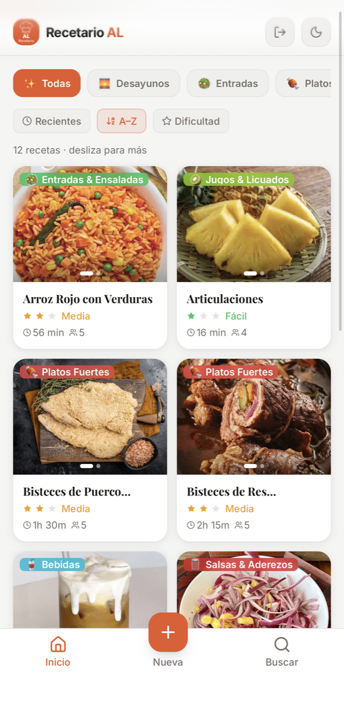
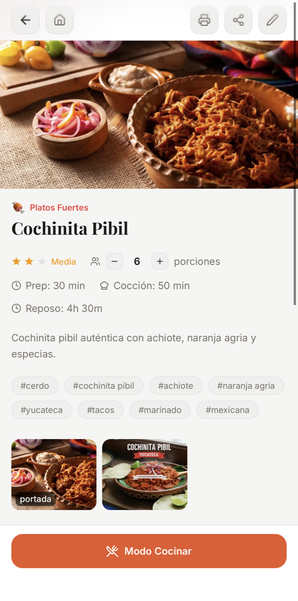
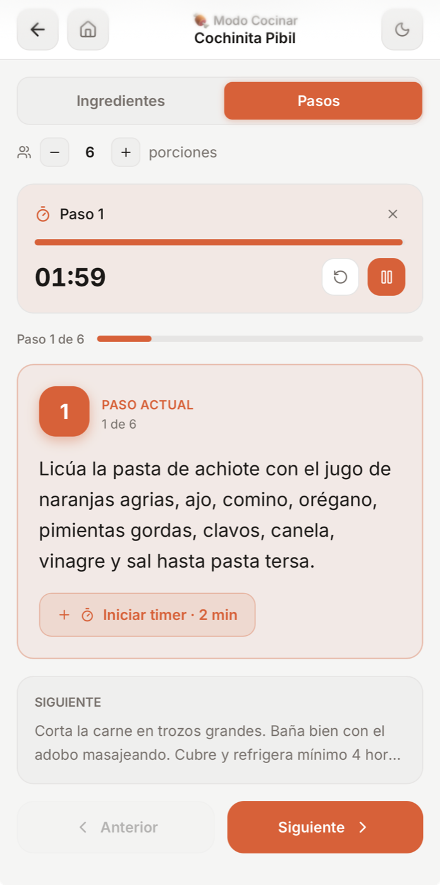

# Recetario AL

Aplicación web mobile-first para guardar, organizar y compartir recetas personales. Permite documentar ingredientes, porciones, tiempos, pasos y fotografías, además de acompañar la preparación con un modo de cocina interactivo.

**[Probar la aplicación](https://recetario.al-miniserver.dev/login)** · [Despliegue alternativo en Vercel](https://recetario-al.vercel.app)

> La instancia pública requiere crear una cuenta para administrar recetas. Cada usuario conserva el control de sus registros mediante autenticación y políticas Row Level Security de Supabase.

## Vista previa

<table>
  <tr>
    <th>Explorar recetas</th>
    <th>Detalle y porciones</th>
    <th>Modo cocinar</th>
  </tr>
  <tr>
    <td></td>
    <td></td>
    <td></td>
  </tr>
</table>

## Funcionalidades

- Creación, edición y eliminación de recetas personales.
- Ingredientes ordenados con cantidades y unidades.
- Ajuste automático de cantidades al cambiar el número de porciones.
- Pasos de preparación con temporizadores opcionales.
- Modo cocinar con lista interactiva, navegación paso a paso y pantalla activa.
- Galería de hasta ocho fotografías por receta y selección de portada.
- Búsqueda por nombre o ingredientes, filtros por categoría y ordenamiento.
- Enlaces públicos para compartir recetas sin exponer el resto del recetario.
- Vista optimizada para impresión.
- Desplazamiento infinito, pull-to-refresh y navegación adaptada a dispositivos móviles.
- Temas claro y oscuro.

## Tecnologías

| Capa | Tecnologías |
|---|---|
| Interfaz | React 19, TypeScript, Vite |
| Estilos | Tailwind CSS, CSS |
| Formularios | React Hook Form, Zod |
| Datos y caché | TanStack Query |
| Backend administrado | Supabase Auth, PostgreSQL y Storage |
| Seguridad | Row Level Security por usuario |
| Despliegue | Vercel, Docker y Nginx |

## Arquitectura

```text
Usuario
  │
  ▼
React + TypeScript
  │
  ├── autenticación
  ├── consultas y mutaciones
  ├── caché con TanStack Query
  └── carga de fotografías
  │
  ▼
Supabase
  ├── Auth
  ├── PostgreSQL + Row Level Security
  └── Storage
```

## Modelo de datos

El recetario separa los datos por usuario y organiza la información en cuatro entidades principales:

- `recipes`: información general, categoría, dificultad, porciones, tiempos y visibilidad.
- `ingredients`: cantidades, unidades y orden de los ingredientes.
- `steps`: instrucciones ordenadas y temporizadores opcionales.
- `recipe_photos`: fotografías, portada y referencias de almacenamiento.

El esquema de referencia y sus políticas de acceso están disponibles en [`supabase-schema.sql`](supabase-schema.sql).

## Ejecución local

### Requisitos

- Node.js 22.13 o posterior
- npm
- Un proyecto de Supabase

### Instalación

```bash
git clone https://github.com/dev1206al/Recetario_AL.git
cd Recetario_AL
npm install
```

Crea el archivo de variables locales:

```bash
cp .env.example .env.local
```

Configura las credenciales públicas de tu proyecto:

```env
VITE_SUPABASE_URL=https://tu-proyecto.supabase.co
VITE_SUPABASE_ANON_KEY=tu-anon-key-aqui
```

Aplica [`supabase-schema.sql`](supabase-schema.sql) desde el SQL Editor de Supabase, crea el bucket público `recipe-photos` y después inicia la aplicación:

```bash
npm run dev
```

Vite mostrará la dirección local en la terminal, normalmente `http://localhost:5173`.

## Comandos disponibles

```bash
npm run dev      # servidor de desarrollo
npm run build    # comprobación de TypeScript y build de producción
npm run lint     # análisis estático con ESLint
npm run preview  # vista previa del build
```

## Docker

El repositorio incluye una imagen multietapa: Node compila la aplicación y Nginx sirve los archivos estáticos con fallback para las rutas del SPA.

```bash
docker build -t recetario-al .
docker run --rm -p 8080:80 recetario-al
```

> Las variables `VITE_*` se incorporan durante la compilación. Configura `.env.local` antes de construir la imagen; pasarlas únicamente con `docker run -e` no modifica el bundle generado.

## Estructura

```text
Recetario_AL/
├── public/                  # logotipo, iconos y manifiesto
├── src/
│   ├── components/          # interfaz, recetas y navegación
│   ├── context/             # autenticación y tema
│   ├── hooks/               # datos, timers e interacciones móviles
│   ├── lib/                 # cliente Supabase y utilidades
│   ├── pages/               # vistas principales
│   └── types/               # tipos y categorías
├── supabase-schema.sql
├── Dockerfile
├── nginx.conf
└── vercel.json
```

## Privacidad y alcance

- Las recetas son privadas por defecto y se relacionan con el usuario autenticado.
- Solo las recetas marcadas como públicas pueden consultarse mediante un enlace compartido.
- La clave `anon` de Supabase es pública por diseño; la protección depende de políticas RLS correctamente configuradas.
- No deben incluirse claves de servicio, contraseñas ni archivos `.env` en el repositorio.

## Autor

**Luis Enrique Alvarez Segura**<br>
Ingeniería en Computación, Universidad Autónoma Metropolitana<br>
[LinkedIn](https://www.linkedin.com/in/luis-enrique-alvarez-segura) · [GitHub](https://github.com/dev1206al)

## Licencia

Este repositorio todavía no declara una licencia de uso. El código permanece bajo los derechos de su autor hasta que se agregue una licencia explícita.
